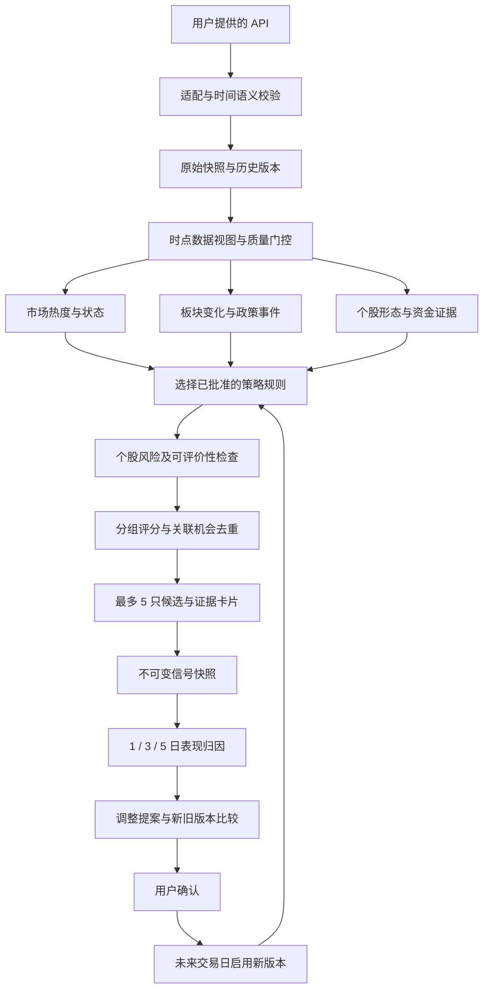

# ATI 整体框架 V0.2

日期：2026-11-11。本文是需求与设计草案；除明确标注为已确认的内容外，其余均为建议。

## 1. 已确认需求

| 项目 | 需求 |
|---|---|
| 核心任务 | 快速筛选符合条件的标的，持续评估并改进筛选条件及因子 |
| 使用窗口 | 交易日 14:30–14:50，Asia/Shanghai |
| 股票范围 | 全部 A 股，排除 ST、*ST；覆盖沪深主板、创业板、科创板、北交所 |
| 新股 | 不因上市时间自动从研究范围排除；因子历史不足必须如实标注 |
| 候选数量 | 每次发布最多 5 只；条件不足时少选或为空 |
| 因子范围 | 大盘热度、市场情况、板块轮动、资金进出、政治政策及个股特征 |
| 观察周期 | 信号日后的第 3 个交易日为主，第 1、5 个交易日辅助 |
| 交易 | 用户手动执行；暂不接入交易模型或券商接口 |
| 迭代控制 | 系统提交调整方案，用户确认后生效 |
| 数据 | 用户后续提供 API，本阶段建立供应商无关的数据契约 |
| 基础设施 | 已有 VPS，不纳入采购及费用讨论 |
| 当前工作 | 完善框架与因子，暂不拆分开发任务 |

候选数量限制针对每一时点的有效名单；窗口内可能因变化出现超过 5 只不同股票。若希望整天累计最多 5 只，属于另一产品规则，需另外确定。本草案采用前者，保留全部变化记录。

## 2. 产品成果与限制

每个候选需要回答：为什么符合条件、当前有哪些支持与反对证据、信息截至何时、什么变化会使筛选逻辑失效。

项目成功由三类指标评估：

- 使用：候选能及时发布，用户能在窗口内理解和比较；无须翻阅大量指标。
- 研究：固定口径的样本外 3 日胜率、收益分布、不利波动及覆盖率可复现。
- 运维：数据过期及任务失败可见，旧信号不能冒充新信号，历史版本可回放。

不以每日必须给足 5 只、宣称某个目标胜率、保证每天有机会作为验收要求。候选得分是排序分，不是上涨概率。

## 3. 逻辑架构

这是一条研究和信号流程，不包含自动下单。政策事件可以触发对板块的观察，但不能跳过个股与数据检查。市场条件决定规则，不通过给所有股票加一个相同分数来伪装排序能力。

## 4. 模块边界

| 模块 | 输入 | 输出 | 必须保留的证据 |
|---|---|---|---|
| 数据适配 | API 响应 | 标准字段与单位 | 原始响应、来源、时间、修订号 |
| 数据质量 | 标准数据 | 可用、降级、阻断状态 | 规则、缺失范围、年龄、原因 |
| 市场环境 | 同步市场截面、历史日线 | 趋势、热度、压力三个维度 | 原始指标与触发条件 |
| 板块与事件 | 历史成分、行情、事件 | 强度变化、催化及风险标签 | 成分版本、原文、传导依据 |
| 因子引擎 | 时点数据、定义版本 | 原值、变换值、有效性 | 公式、依赖、窗口、缺失原因 |
| 策略引擎 | 因子、环境、批准规则 | 资格判定与分组评分 | 命中及未命中的规则 |
| 候选发布 | 策略结果、关联性 | 最多 5 只候选 | 排序、剔除原因、发布时间 |
| 信号评价 | 固定快照、后续价格 | 1/3/5 日标签与限制 | 参考价格、成本、可成交性假设 |
| 研究迭代 | 历史版本与评价 | 调整提案 | 全部试验记录、对照及失败结果 |
| Web | 信号与状态 | 手机优先的决策界面 | 数据与计算时间、策略版本 |

## 5. 时间和发布规则

建议 14:30、14:35、14:40、14:45、14:50 五次计划更新。行情采集可比发布更频繁；频率最终取决于 API 能力，不能凭计划推断数据实时性。

每一轮包含独立的 `decision_cutoff`、`published_at`、`market_asof`。计算只使用在截点前已发生且已可知的数据。实际发布延迟也进入参考价格和使用体验评价。

- 盘前或前一盘后：准备截至当时已知的历史日线因子、股票状态、历史成分和已公开事件。
- 窗口开始前：检查全市场覆盖、各板块覆盖和时钟一致性。
- 窗口内：全市场轻量过滤，对可用候选做详细计算；不能只看昨日白名单而漏掉当日变化。
- 每轮发布：生成新快照，已发布旧快照只读；用户可以查看名单变化及原因。
- 窗口结束：保存本日全部发布，后续数据只进入评价，不覆盖当时的判断。

研究初值：市场覆盖不低于预期可交易股票的 95%，且各交易板块不低于 90%；最新行情时间距截点不超过 90 秒。指标覆盖率和失联范围同时展示。这些值是工程候选阈值，必须在接口评估后校准和批准。单个市场缺失不能被其他市场的高覆盖掩盖。

若 API 已知延迟无法满足窗口要求，不以降低时间标准的方式宣称满足实时目标；应显式重新评估产品能力。

普通排名更新可使用稳定性规则减少抖动，例如新候选需领先现有末位一个预设分差才替换。一旦检测到风险阻断或数据过期，立即退出有效名单；实际检测延迟受采集频率约束，不能承诺发现尚未收到的信息。稳定性规则单独版本化，研究时同时保留原始排序与展示排序。

## 6. 市场状态：先使用可解释的多维规则

市场状态拆为：

1. 趋势：上涨结构、横向结构、下跌结构。
2. 热度：冷、正常、活跃、过热迹象。
3. 压力：正常、波动放大、流动性或下跌压力。

维度可以同时存在，例如“上涨结构 + 活跃 + 波动放大”。不强制把所有情况塞进四个互斥标签。状态边界由训练区间分位数、连续观察规则等定义，不能用全样本回看后的分位数。

建议状态动作：

| 环境特征 | 已批准规则可以采取的动作 |
|---|---|
| 趋势和宽度共同改善 | 允许回调恢复与突破延续两个策略参与 |
| 市场上涨但宽度恶化、集中度升高 | 提高板块内部支持要求，提示候选集中风险 |
| 热度高且个股远离历史价格区间 | 加强延伸和拥挤检查，不因热度高直接加分 |
| 市场下跌压力或数据异常 | 降低合格候选数量；可输出空名单 |
| 状态不确定 | 保留不确定标签；不强行切换到表现最好的历史状态 |

允许执行的是用户已批准的状态切换规则。新增状态、改变阈值及调整策略权重均视为新版本，不能在线自行修改。

## 7. 策略结构与初始研究组合

### 7.1 两类策略与一个对照

- `TR` 趋势回调恢复：已有趋势及板块支持，近期出现回调，当日截至观察时点出现恢复迹象。
- `BR` 整理突破延续：已有价格结构及板块支持，当前突破此前区间，尚未明显回落或过度延伸。
- `BM` 简单相对动量对照：使用同样的股票范围、数据时间和基本风险检查，只按简化动量条件排序。

TR 与 BR 是研究建议，不是已验证有效策略。它们共用市场背景、数据与风险规则，但保留独立信号身份。若同一股票同时入选，只展示一次，保留全部触发原因。

### 7.2 基础规则模板

所有数值都是研究初值，不能跳过验证直接成为正式交易建议。

| 条件 | TR 研究模板 | BR 研究模板 |
|---|---|---|
| 历史条件 | 足以计算 MA60、ATR14 等必要字段 | 足以计算 MA60、历史高点与 ATR14 |
| 趋势 | 前一日 MA20 > MA60 | 前一日 MA20 > MA60 |
| 板块支持 | S01 相对收益为正，S02 上涨占比 > 50% | 同左 |
| 形态条件 | I03 的回调深度在 0.5–2 ATR，且恢复条件成立 | I04 突破距离在 0–1 ATR，过去 20 日区间宽度处于自身历史较低分位 |
| 当前配合 | 当前价 > 当日 VWAP，I05 非负 | 当前价 > 当日 VWAP，I05 非负 |
| 风险 | 通过 R02、R05、R06，检查延伸及已知事件 | 同左 |

整理区间较低分位建议先试过去 120 个有效窗口的 40% 分位；不足历史时该 BR 模板不可评价，不用当日全市场分位替代。TR/BR 因此暂不为极短历史新股输出同口径正式候选；这些股票仍在研究池，若需覆盖其正式筛选，应另建短历史策略并独立验证。

股票池覆盖全市场，不意味着每个策略必须对每只股票都给出分数。

### 7.3 评分方法

基础评分先使用个股与板块两组，初始以组等权建立可解释基线；成交活跃度在 F01 数据达到可用状态后作为独立增强组：

`BaseScore_v0 = (IndividualScore + SectorScore) / 2`

`BaseScore_activity_v1 = (IndividualScore + SectorScore + ActivityScore) / 3`

建议组内起点：

- IndividualScore：基础版使用 I01；I05 处于影子状态，待分钟数据验证后再进入增强版。I02、I03/I04、I06 用作策略资格及解释，先不重复计分。
- SectorScore：基础版先使用 S01 的当日相对收益；S03、S01 的历史 5 日字段先作诊断，S02 用作资格；S04–S06 先作诊断。S03 的同刻历史数据可用并通过验证后，才进入增强版。
- ActivityScore：F01 的有界得分；F02 先作诊断，避免全天与尾盘成交量重复加权。当前 F01 处于影子状态，不能进入 `BaseScore_v0`。

每组 0–100，等权只是一条基线。分位数是同一时点、预定义比较池中的相对位置，不是预测概率。F01 在历史训练分布高端封顶；极端放量列入风险解释，不能无限加分。截断分位与比较池由版本声明。

基础配置的可评估性不是收益优势。第一轮需在共同数据范围上比较“二组基线”“仅个股排序”“加入板块”“加入成交活跃度”等版本，不能把新增因子默认视为有效。

TR/BR 若比较池不同，不能把各自百分位直接混排。首轮建议使用共同的基础比较池生成上述因子分位，形态只决定资格。之后若采用不同模型，需要以独立验证数据校准可比较的排序指标。

资金增强与事件增强分别建立实验版本：F03–F06 不在基础版缺失时自动填 0；P01–P07 先形成带来源的条件和标签。只有在资料充分、标签规则批准并验证后，事件才可作为正向资格或有限加分项。政策负面硬拦截也必须有明确的已批准规则，不能由临时文本判断自行决定。

禁止每只股票按自身缺失情况随意重新分配权重。基础版、资金增强版、事件增强版必须有固定依赖及独立验证记录；共同有效样本用于比较效果，覆盖差异另列。

### 7.4 风险处理与名单关联性

- 数据、ST 状态和交易状态是资格约束；不能由机会高分抵消。
- 延伸、拥挤、跳空历史及事件不确定性可作为提醒；是否额外扣分或阻断须在策略版本明确。
- 同一风险不同时在分数和门控中重复处罚，除非能解释两种不同用途并单独验证。
- 最终最多 5 只；候选高度相关或同一事件驱动时提示关联。可研究“每一行业/事件簇最多 2 只”，但不默认擅自启用该数量限制。
- 缺少用户持仓时，只能报告候选之间的关联，不能宣称已控制用户整个账户的风险。

## 8. 因子与策略迭代

因子状态：`研究定义 → 数据核验 → 历史研究/前向积累 → 影子观察 → 提交方案 → 确认生效 → 监控/停用`。

每个提案必须包含：

- 问题、假设及具体变更；新增变量与删除变量。
- 使用数据、样本区间、信号数量、交易日数量及有效市场覆盖。
- 新旧策略在相同日期与口径下的表现，以及覆盖变化。
- 3 日胜率、平均净参考收益、不利波动、1/5 日辅助表现及不确定区间。
- 去掉该因子后的对照；对成本、时点和阈值的敏感性。
- 所有试验次数、失败结果、未满足条件及尚未观察到的市场环境。
- 建议启用日期、影响范围和可恢复的旧版本。

正常规则变更只能由用户确认；默认下一交易日生效。窗口内不切换版本。数据异常触发已有安全规则，不属于新策略审批。

停用策略保留影子观察，否则缺少恢复依据。表现恶化先排查数据、市场和执行参考偏差，不能直接命名为 Alpha 衰减。

## 9. 手机端信息结构

首页第一屏：今日数据状态、市场摘要、当前有效候选数、最多 5 张候选卡片。

每张卡片：代码与板块、策略类型、主要入选依据、主要风险、最新数据时间、变化原因、有效性状态。展开后查看原值、比较基准、历史证据及事件原文。

固定区分：

- “没有符合条件的股票”与“数据不足，无法判断”。
- “有效候选”与“历史快照/已失效候选”。
- “无已知事件”与“事件源未覆盖”。
- “排序分”与“有充分样本后才能估计的成功概率”。

主导航建议：今日候选、信号复盘、策略提案、数据与设置。保留自选/忽略及原因记录；不要求用户录入交易才能使用选股功能。

## 10. 技术与存储框架

建议模块化 Python 项目，API 与后台任务分进程运行，PostgreSQL 存业务数据，原始响应及研究快照可用带校验和的文件存储。前端响应式 Web，Docker Compose 部署。暂不把 Redis、TimescaleDB、HMM、外部 AI API 设为必要依赖。

必要数据实体：

| 实体组 | 内容 |
|---|---|
| 时间与标的 | 交易日历、证券身份及历史状态、板块与行业历史成分、公司行为 |
| 行情与事件 | 原始批次、标准行情、资金统计口径、事件原文及修订、事件与行业映射 |
| 因子与规则 | 因子定义版本、依赖、参数、计算结果、市场状态、策略批准版本 |
| 发布与复盘 | 发布轮次、候选与拒绝原因、信号快照、参考价格、评价标签及缺失状态 |
| 研究与审批 | 实验记录、对照、提案、确认记录、生效及恢复记录 |
| 运维 | 数据质量、任务状态、延迟、异常、备份与恢复记录 |

同一交易日、截点、策略版本和数据批次的任务重复运行应幂等。补录或修订数据形成新研究版本，不能改写原发布快照。只部署一个调度入口，API 请求不触发全市场重算。

个人访问需要认证和 HTTPS；API 密钥存服务端，不出现在浏览器或日志。数据库不直接暴露公网。备份包含规则、审批与信号快照，并验证可恢复性。

## 11. 尚待核验，不阻碍本轮框架设计

- 用户 API 的字段、时效、板块覆盖和历史深度。
- 事件来源和公司业务映射的证据质量；是否有历史版本。
- 正式启用的阈值、因子组合、参考成本和数据时效目标。
- 最终主评价快照建议采用 14:50，但这是评估设计建议，不是已验证的最优买入时间。

后续以这些文档作为需求审阅基础，不据此自动开始编码、部署、采购或任务拆分。
